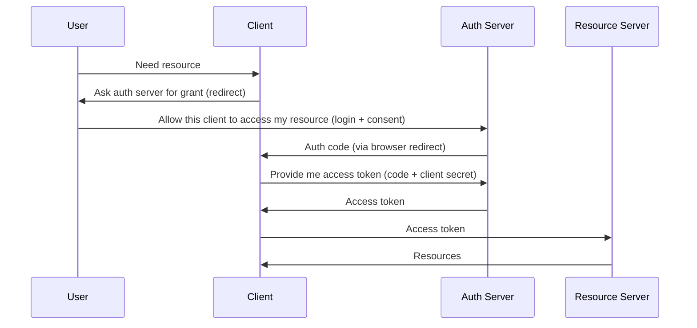
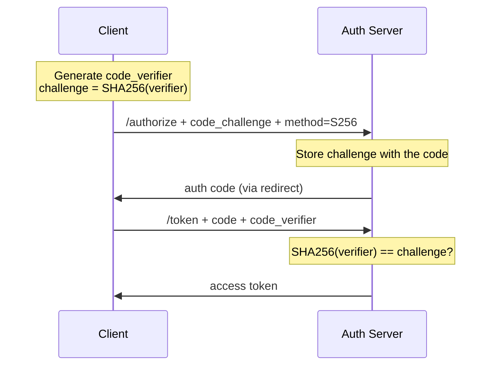

# OAuth 2.0: Authorization Code Flow

**When it's used:**

- An end user is involved
- The user enters credentials (on the auth server, never on the client)

**Actors:** User (Resource Owner) · Client · Authorization Server · Resource Server

---

## Flow Overview



---

## Step 1: Build the Authorization URL

First, generate `state`, a random string used as a CSRF token.

```
https://authorization-server.com/authorize
  ?response_type=code                                 ← Auth Code flow
  &client_id=xxx....xxx
  &redirect_uri=https://mysite.domain.com/dash
  &scope=name email openid profile photos
  &state=random-secure-string
```

| Parameter       | Purpose                                                                           |
| --------------- | --------------------------------------------------------------------------------- |
| `response_type` | `code` selects the Authorization Code flow                                        |
| `client_id`     | Identifies the registered client app                                              |
| `redirect_uri`  | Where the auth server sends the user back (must match the registered URI exactly) |
| `scope`         | Permissions requested (`openid` turns on OIDC)                                    |
| `state`         | Random value to protect against CSRF                                              |

---

## Step 2: Login and Consent

- The user is redirected to the auth server's **login screen**
- Then to the **consent page**, which lists the requested scopes
- After approval, the user is **redirected back to the client**

---

## Step 3: Handle the Redirect and Verify `state`

The auth server adds query parameters to your redirect URL:

```
https://mysite.domain.com/dash
  ?code=6IBxpZr4U3OfJBk5732JIpNh4
  &state=random-secure-string
```

- **Verify `state`**: compare it to the value generated in Step 1
  - ✅ Match → proceed
  - ❌ No match → the request or data has been tampered with → **restart the flow**

> 💡 The auth code is **short-lived** (usually seconds to minutes) and **single-use**.

---

## Step 4: Exchange the Auth Code for an Access Token

Build a POST request to the auth server's token endpoint:

```http
POST https://authorization-server.com/token
Content-Type: application/x-www-form-urlencoded

grant_type=authorization_code
&client_id=xxx
&client_secret=xxx
&redirect_uri=https://mysite.domain.com/dash
&code=auth-code-received
```

**Note:** Some servers ask for `client_id` and `client_secret` as **Basic Auth** (`Authorization: Basic base64(client_id:client_secret)`) instead of in the body.

> 💡 These parameters go in the **request body** (form-encoded), not the URL query string. This happens **server-to-server** (back channel), so the secret never touches the browser.

### Token Endpoint Response

```json
{
  "token_type": "Bearer",
  "expires_in": 86400,
  "access_token": "xxx......xxx",
  "scope": "photo offline_access openid profile",
  "refresh_token": "xxx-----xxxxx"
}
```

| Field           | Meaning                                                           |
| --------------- | ----------------------------------------------------------------- |
| `token_type`    | `Bearer`: whoever holds it can use it                             |
| `expires_in`    | Lifetime in seconds (86400 = 24 hours)                            |
| `access_token`  | Sent to the resource server                                       |
| `scope`         | Scopes actually granted (can be fewer than requested)             |
| `refresh_token` | Used to get new access tokens; issued because of `offline_access` |

> 💡 With the `openid` scope, the response also includes an **`id_token`** (a JWT with the user's identity). That's the OIDC layer.

---

## Step 5: Call the Resource Server

```http
GET https://api.resource-server.com/photos
Authorization: Bearer <access_token>
```

The resource server validates the token (signature, expiry, scopes) and returns the resources.

### Renewing with the Refresh Token

```http
POST https://authorization-server.com/token

grant_type=refresh_token
&refresh_token=xxx-----xxxxx
&client_id=xxx
&client_secret=xxx
```

This returns a new access token without involving the user again.

---

## PKCE (Proof Key for Code Exchange)

### The Problem It Solves

- **Public clients** (mobile apps, SPAs) **can't keep a `client_secret`**, because anyone can extract it from the app.
- Without a secret, a **stolen auth code** (from a malicious app on the same redirect scheme, logs, or browser history) could be exchanged for a token by an attacker.

PKCE fixes this by having the client **prove it's the same app that started the flow**, using a one-time secret generated for each login.

### How It Works

**1. Before Step 1:** the client generates:

- `code_verifier`: a random, high-entropy string (43–128 characters), **kept secret** on the client
- `code_challenge` = `BASE64URL(SHA256(code_verifier))`

**2. Step 1 (Authorization URL):** add two parameters:

```
https://authorization-server.com/authorize
  ?response_type=code
  &client_id=xxx
  &redirect_uri=https://mysite.domain.com/dash
  &scope=openid profile photos
  &state=random-secure-string
  &code_challenge=E9Melhoa2OwvFrEMTJguCHaoeK1t8URWbuGJSstw-cM
  &code_challenge_method=S256
```

The auth server **stores the challenge** alongside the auth code it issues.

**3. Step 4 (Token Exchange):** send the original verifier:

```http
POST https://authorization-server.com/token

grant_type=authorization_code
&client_id=xxx
&redirect_uri=https://mysite.domain.com/dash
&code=auth-code-received
&code_verifier=dBjftJeZ4CVP-mB92K27uhbUJU1p1r_wW1gFWFOEjXk
```

**4. The auth server verifies:** `SHA256(code_verifier) == stored code_challenge`?

- ✅ Match → issues the token
- ❌ No match → rejects the request

### Why It's Secure

- Only the **hash** (the challenge) travels through the browser, in the front channel.
- The **verifier** is sent only once, directly to the token endpoint.
- An attacker who steals the code doesn't have the verifier, so **the code is useless to them**.

### PKCE Flow



### What PKCE Changes vs. the Standard Flow

| Aspect                   | Standard Auth Code              | Auth Code + PKCE                          |
| ------------------------ | ------------------------------- | ----------------------------------------- |
| Proof of client          | `client_secret` (static)        | `code_verifier` (new for every login)     |
| Works for public clients | ❌ No (secret can't be hidden)  | ✅ Yes                                    |
| Stolen auth code         | Usable if the secret has leaked | Useless without the verifier              |
| Extra params in Step 1   | None                            | `code_challenge`, `code_challenge_method` |
| Extra params in Step 4   | `client_secret`                 | `code_verifier` (secret optional)         |

### `state` vs. PKCE

| `state`                                               | PKCE                                                  |
| ----------------------------------------------------- | ----------------------------------------------------- |
| Protects the **client** from CSRF (a forged callback) | Protects the **code** from being used by someone else |
| Checked by the **client**                             | Checked by the **auth server**                        |

Use **both**: they protect against different attacks.

### Key Points

- Always use `S256`. The `plain` method (challenge = verifier) offers little protection.
- **OAuth 2.1 recommends PKCE for all clients**, including confidential server-side apps that also have a secret.
- Spring Security and Keycloak support PKCE out of the box.

---

## Topics to Cover

**Internals of Spring Security:**

- JWT
- OAuth 2.0
  - PKCE
  - Auth Code
  - Client Credentials
- OIDC
- Keycloak
- Diagrams in draw.io

**System Design / Projects:**

- Java-only Notification System
- Spring Boot version
- Booking System
- Chat System
- AI Implementations
