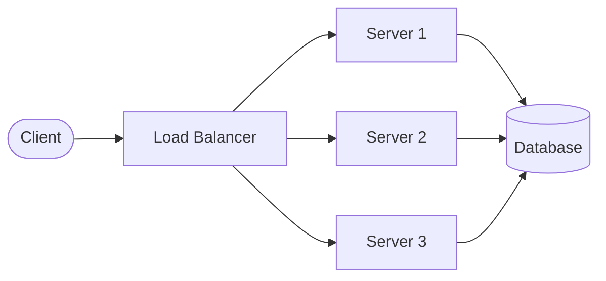

# System Design: Load Balancing

> Part of the [System Design](../index.md) series.

---

A load balancer sits in front of a fleet of servers and distributes incoming requests across them. It also performs health checks and stops routing to unhealthy nodes.

## L4 vs L7 Load Balancer

**L4 (transport layer)** — routes based on IP address and TCP/UDP port. It doesn't look at the request content. Fast and low overhead. Used when you just need to distribute raw TCP connections (e.g., database proxies, game servers).

**L7 (application layer)** — routes based on HTTP content: URL path, headers, cookies, request body. Can do path-based routing (`/api` → API servers, `/static` → asset servers), sticky sessions, SSL termination, and content-based routing. More flexible, slightly more overhead. Most web systems use L7.

**Interview note:** "An L7 load balancer lets me route `/payments` to a dedicated payment service and `/catalog` to the product service — that's how you start decomposing a monolith."

## Load Balancing Algorithms

**Round-robin** — requests go to each server in rotation. Simple, works when all servers are identical.

**Weighted round-robin** — some servers get more requests (useful when nodes have different capacities).

**Least connections** — new request goes to the server with the fewest active connections. Better for long-lived connections (WebSocket, file uploads) where round-robin would pile up.

**IP hash** — hash the client's IP to always route them to the same server. This is **sticky sessions at the load balancer level** — same client always hits the same node. Useful when you can't fully externalize session state.

**Random with two choices** — pick two servers at random, send to the less loaded one. Surprisingly effective, avoids herd behavior of pure random.

## Health Checks

The load balancer pings each server on a configured endpoint (e.g., `GET /health`) at regular intervals. If a server fails N consecutive checks, it's removed from rotation. When it recovers, it's added back. This is how horizontal scaling achieves fault tolerance automatically.

## SSL Termination

The load balancer decrypts HTTPS traffic and forwards plain HTTP internally. Servers don't need TLS certs — they trust the internal network. Reduces CPU overhead on application servers.
