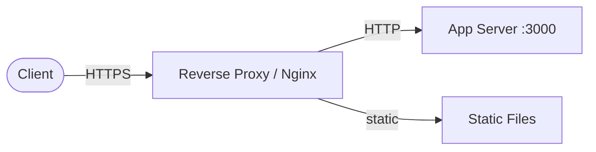
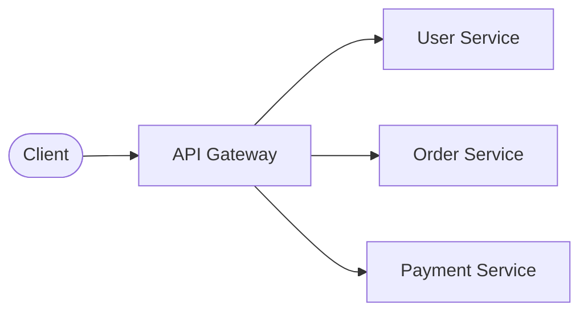

# System Design: Reverse Proxy & API Gateway

> Part of the [System Design](../index.md) series.

---

## Reverse Proxy

A **reverse proxy** sits in front of servers and forwards client requests to them. It looks like the server to the client. Nginx and Caddy are common reverse proxies.

**Don't confuse:**

- **Forward proxy** — the client uses a proxy to talk to the internet (hides the client). Corporate firewalls, VPNs.
- **Reverse proxy** — the server uses a proxy to receive traffic from the internet (hides the server). Nginx in front of your Node app.

**What reverse proxies do:**

- SSL termination
- Caching (static assets)
- Compression (gzip responses)
- Rate limiting
- Authentication checks before passing to the app
- Serving static files directly without hitting the app server

**Load balancer vs reverse proxy:** a load balancer distributes across _multiple_ backends. A reverse proxy may forward to a single backend — it's about the functions it performs (security, caching, SSL). Many tools (Nginx, HAProxy, AWS ALB) do both.

---

## API Gateway

An API gateway is the single entry point for all client requests. It sits in front of all microservices.

**What it does:**
- **Routing** — `/orders` → Order Service, `/users` → User Service
- **Authentication** — verify JWT/session once at the gateway, not in every service
- **Rate limiting** — throttle clients before the request reaches any service
- **Request aggregation** — combine calls to multiple services into one response (BFF pattern)
- **Protocol translation** — accept REST from clients, forward gRPC internally

**API Gateway vs Reverse Proxy:** a reverse proxy is a general-purpose request forwarder; an API gateway is application-aware and built specifically for microservices — it understands services, routes, auth, and aggregation.
