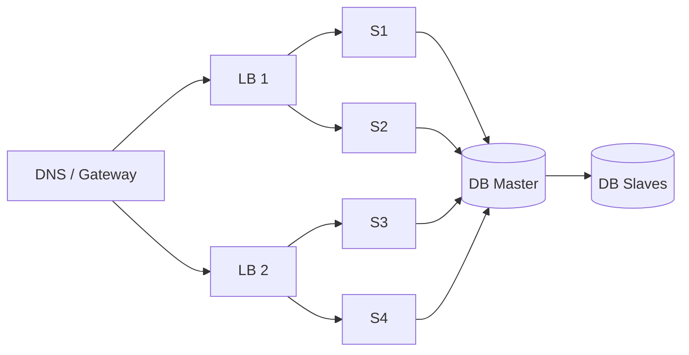

# System Design: Single Point of Failure (SPOF) & High Availability

> Part of the [System Design](../index.md) series.

---

A **single point of failure** is any component whose failure brings down the whole system. The goal of fault-tolerant design is to eliminate SPOFs.

**Problem:** multiple services depend on one service. When that service fails, everything depending on it fails.

## Common SPOFs and Their Fixes

| Component | SPOF risk | Fix |
|---|---|---|
| Single server | Server crash = full outage | Horizontal scaling + load balancer |
| Single database | DB crash = no reads or writes | Primary + replica with failover |
| Single load balancer | LB crash = no traffic routes | Redundant LBs (active-passive or active-active) |
| Single datacenter | Power/network outage | Multi-region deployment |
| Single DNS provider | DNS failure = site unreachable | Multiple DNS providers |
| Shared mutable state | One bad write corrupts everyone | Isolation (per-tenant DBs, namespacing) |

## Redundancy Patterns

- **Active-passive** — one node handles traffic, the standby takes over on failure. Simple but wastes capacity.
- **Active-active** — both nodes handle traffic simultaneously, each is a failover for the other. Requires load balancing between them and consistent state.

## Cascading Failures

A SPOF can be indirect. A single slow dependency (a third-party API) can hold all your connection pool threads, starving every other request. Use **timeouts**, **circuit breakers**, and **bulkheads** (isolate failure domains) to prevent one bad component from cascading.

**Interview note:** "Every time I add a component, I ask: is this now a SPOF? If so, what's the redundancy strategy?"

## Multi-Layer Redundancy Diagram

