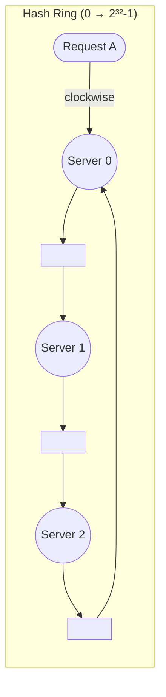

# System Design: Consistent Hashing

> Part of the [System Design](../index.md) series.

---

## The Problem with Naive Load Balancing

Simple modulo hashing: `server = hash(request_id) % N`

Works fine until you add or remove a server. When N changes, almost every key remaps to a different server. This breaks sticky routing — sessions, caches, and shard assignments all get invalidated at once.

```
N=3: hash(10) % 3 = 1 → Server 1
N=4: hash(10) % 4 = 2 → Server 2  ← same request, different server
```

For a cache cluster, this means a mass cache miss event when you scale — every node is suddenly responsible for different keys.

---

## How Consistent Hashing Fixes It

Both servers and requests are hashed onto a **ring** of integers (0 to 2^32 - 1). A request routes to the first server clockwise from its hash position on the ring.



**When a server is added or removed**, only the keys between that server and its predecessor on the ring are remapped. All other keys are unaffected. With N servers, adding one server remaps ~1/N keys instead of nearly all of them.

**Virtual nodes:** a single physical server maps to multiple positions on the ring. This distributes the load more evenly (without virtual nodes, uneven spacing causes some servers to handle far more keys). It also smooths the redistribution when a node is added or removed.

**Where it's used:** distributed caches (Redis Cluster, Memcached), database sharding, CDN routing, consistent load balancing for session affinity.

**Interview note:** "Consistent hashing is the solution whenever you need stable key-to-node mapping that survives topology changes."
