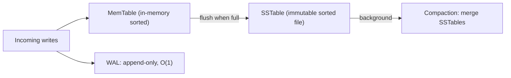

# System Design: How Databases Scale Writes

> Part of the [System Design](../index.md) series.

---

## The Problem

Relational databases are optimized for random reads (B+ tree indexes). Random writes are expensive: each write requires finding the right position in the B+ tree, possibly rebalancing it, flushing dirty pages to disk, and writing a WAL entry. Under high write load, this becomes the bottleneck.

---

## Solution 1: Write Coalescing (Request Condensing)

Batch many small writes into a single larger I/O. Instead of writing each row change to disk immediately, buffer writes in memory and flush as a single batch.

**Tradeoff:** buffered writes not yet flushed can be lost on a crash. Acceptable for metrics, analytics, counters — not for financial transactions.

---

## Solution 2: LSM-Tree (Log-Structured Merge Tree)

The design behind Cassandra, RocksDB, LevelDB, and ClickHouse. Optimized for write throughput by turning random writes into sequential ones.

### How it works

**Step 1 — Write to memory (MemTable):** all incoming writes go into an in-memory sorted structure (the MemTable). This is O(log n) but entirely in-memory — very fast.

**Step 2 — WAL for durability:** simultaneously, the write is appended to a Write-Ahead Log on disk (sequential I/O, O(1)). This is the crash recovery mechanism — if the server dies before the MemTable is flushed, the WAL replays the writes on restart.

**Step 3 — Flush to SSTables:** when the MemTable fills up, it's flushed to disk as an immutable sorted file called an **SSTable** (Sorted String Table). Sequential write to disk — fast.

**Step 4 — Compaction:** over time, many SSTables accumulate. A background process merges and sorts them (merge-sort), eliminating deleted/overwritten keys and producing larger, more efficient sorted files. This is **compaction**.

### Why reads are slower on LSM-Trees

A key might exist in the MemTable, or in any of several SSTables. A read must check all of them in order (newest first) until it finds the key. Mitigations:

- **Bloom filters** — a probabilistic structure per SSTable that quickly says "this key definitely isn't here" — skips most SSTables without reading them.
- **Block index** — an index at the top of each SSTable allows binary search to find the right block.

---

## B+ Tree vs LSM-Tree

| | B+ Tree | LSM-Tree |
|---|---|---|
| Write pattern | Random I/O (find position in tree) | Sequential I/O (append to WAL + flush) |
| Read pattern | Single lookup O(log n) | May check multiple SSTables |
| Write amplification | Low | High (compaction rewrites data multiple times) |
| Read amplification | Low | Higher (Bloom filters reduce but don't eliminate) |
| Space amplification | Low | Higher (deleted keys linger until compaction) |
| Used by | Postgres, MySQL (InnoDB), SQLite | Cassandra, RocksDB, LevelDB, ClickHouse |
| Best for | Read-heavy, mixed workloads | Write-heavy workloads |

---

## Write-Ahead Log (WAL)

Both B+ trees and LSM-trees use a WAL for durability. Every write is first appended to the WAL (sequential, fast) before modifying the main data structure. On crash, the WAL replays any writes that weren't yet written to the main storage.

The WAL is what makes databases ACID-durable without paying the cost of a full fsync on every write to the main data file.

---

## Gotchas

- LSM-tree compaction runs in the background but competes for I/O — heavy write loads can cause **compaction lag**, where SSTables accumulate faster than compaction can merge them, degrading read performance.
- Write coalescing (batching) trades durability for throughput — make sure the tradeoff is explicitly acceptable before using it.
- For write-heavy workloads, also consider sharding (see [partitioning-sharding.md](partitioning-sharding.md)) to distribute writes across multiple nodes rather than trying to make one node absorb all of them.
