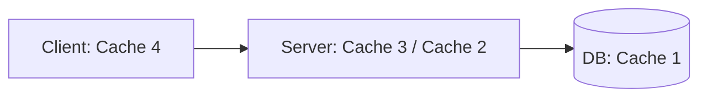

# System Design: Caching

> Part of the [System Design](../index.md) series.
>
> Note: this file will be replaced with the detailed caching notes from [database/08-caching.md](../../database/08-caching.md).

---

Caching avoids expensive and repeated tasks. A cache can sit at several layers:

## Key Concerns

1. **Managing the cache**
2. **Eviction policy**: LRU, LFU, etc.; TTL; invalidation
   - Poor policy leads to:
     - **Thrashing** (constant eviction and reloading)
     - Costly operations
     - Processing latency

## Consistency

- Caches are **eventually consistent**, but _when_ do they catch up?
- Example: Server has **v4**, cache still has **v2**

## Where to Put the Cache?

- At large scale, use **all three layers** ✓

## Cache Stampede

- Many cache misses at once → the DB gets overloaded
- **Fix:** locking (plus other techniques; see the note below)

## Distributed Caches

_(No notes yet.)_
