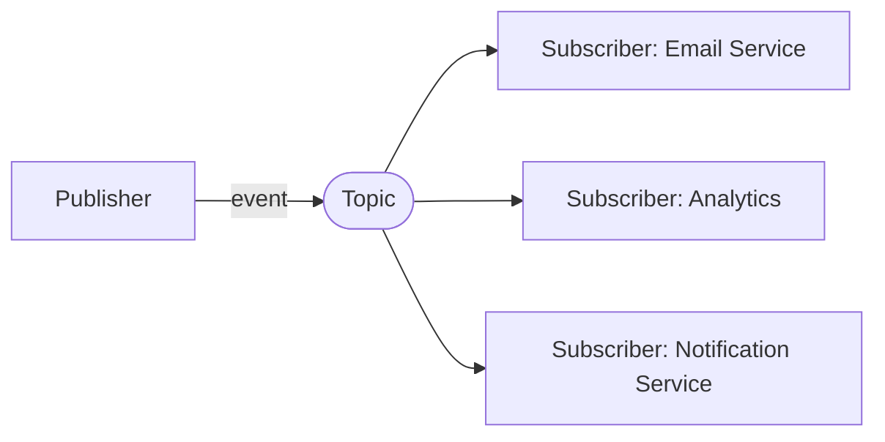

# System Design: Pub/Sub (Publish-Subscribe)

> Part of the [System Design](../index.md) series.

---

Pub/sub is a messaging pattern where **publishers** send messages to a **topic** and **subscribers** each receive their own copy. Unlike a queue (where a message is consumed once by one consumer), pub/sub **fans out** — one event goes to many independent subscribers simultaneously.

**Key difference from a queue:**

| | Queue | Pub/Sub |
|---|---|---|
| Consumers | One consumer group processes each message | Every subscriber gets a copy |
| Use case | Work distribution (one worker does the job) | Event broadcasting (many systems react to one event) |
| Example | "Process this payment" → one payment worker | "Order placed" → email + analytics + inventory all react |

**Publishers are decoupled from subscribers** — the publisher doesn't know who is listening or how many subscribers exist. Adding a new subscriber requires no change to the publisher.

## Real-World Tools

**AWS SNS** — pure pub/sub. A topic fans out to email, SMS, SQS queues, Lambda functions, and HTTP endpoints simultaneously. SNS + SQS is a common pattern: SNS fans out the event, each subscriber gets its own SQS queue to process at its own pace.

**Kafka** — supports both. A topic with multiple consumer groups behaves like pub/sub — each group gets all messages independently. A topic with one consumer group behaves like a queue.

**Redis Pub/Sub** — lightweight in-process pub/sub. No persistence — if a subscriber is offline when a message is published, it's lost. Use only for real-time broadcast (live chat, presence updates) where loss is tolerable.

## Common Use Cases

- **Order placed** → fan out to: inventory reservation, email confirmation, analytics, fraud check
- **User signed up** → fan out to: welcome email, CRM sync, A/B test assignment
- **Price changed** → fan out to: search index update, CDN cache invalidation, subscriber notifications

**Interview note:** "When one event needs to trigger multiple independent downstream actions, pub/sub is the right model. If I use a queue with one consumer, I'd have to couple all that logic into one place. With pub/sub, each service subscribes independently and I can add new subscribers without touching existing code."
