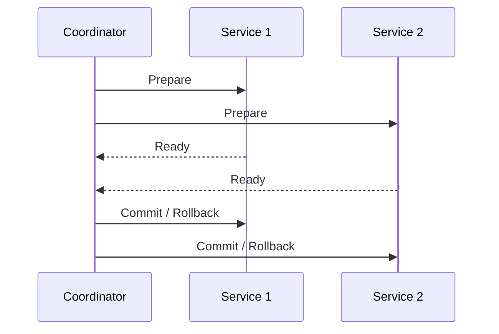
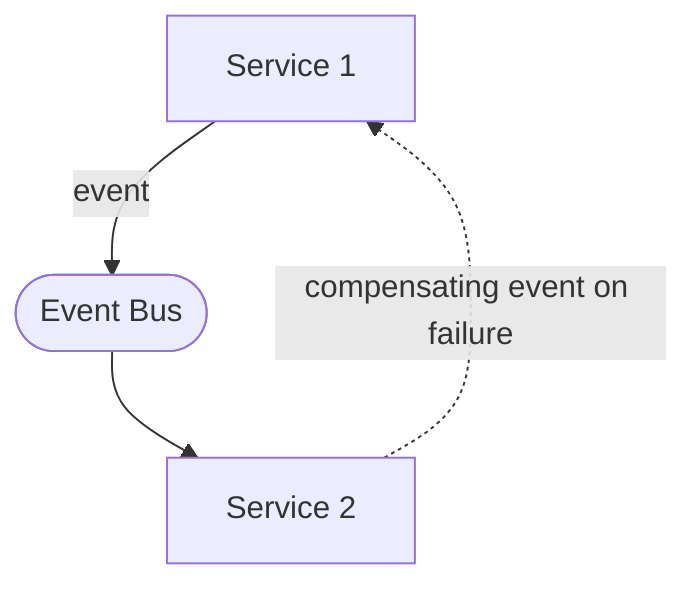
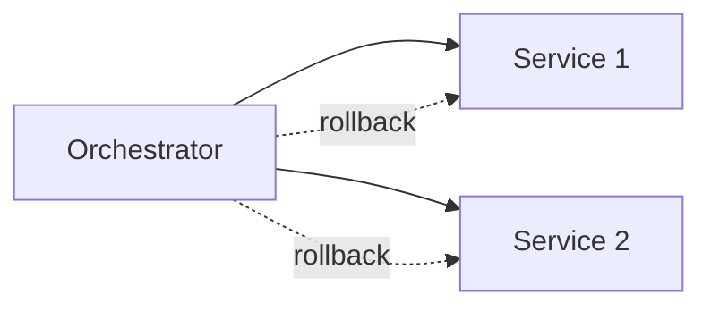

# System Design: Saga & Distributed Transactions

> Part of the [System Design](../index.md) series.

---

A distributed transaction spans multiple services — you can't use a single DB transaction across service boundaries.

## 2PC vs. SAGA

| | 2PC (Two-Phase Commit) | SAGA |
|---|---|---|
| Consistency model | Strong atomicity | Eventual consistency |
| Coordinator | A single coordinator manages all services | Choreographer (events) or Orchestrator (central) |
| Blocking | Client waits for all services to confirm | Each service commits locally |
| Failure | A failure can leave the transaction open across services | Rolls back previous steps via compensating transactions |
| Performance | O(slowest service) — synchronous | Async — faster overall |
| Complexity | Simpler logic, hard to implement correctly at scale | More complex rollback logic |

## 2PC Flow

## SAGA Flow

**Choreography (event-driven):** each service listens for events and publishes its own. No central coordinator. Harder to trace end-to-end.

**Orchestration:** a central orchestrator tells each service what to do and handles rollback explicitly. Easier to understand but the orchestrator becomes a potential SPOF.

**Interview note:** "For the checkout flow — reserve inventory, process payment, create order — I'd use a SAGA with orchestration. If payment fails, the orchestrator fires a compensating transaction to release the inventory reservation."
