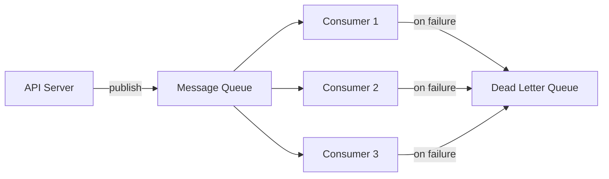

# System Design: Message Queue

> Part of the [System Design](index.md) series.

---

## Why Message Queues

A message queue decouples a **producer** (the service that creates work) from a **consumer** (the service that processes it). Without a queue, the producer must wait for the consumer to finish — a slow consumer blocks everything upstream.

**What queues fix:**
- Keeps user-facing APIs fast — hand off slow work (email, resizing, analytics) to a queue and return 200 immediately
- Absorbs traffic spikes — consumers process at their own pace; the queue buffers the burst
- Fault isolation — if a consumer crashes, messages stay in the queue and are reprocessed when it recovers
- Decouples services — the producer doesn't know or care who consumes the message

---

## Core Vocabulary

**Producer** — the service that publishes messages to the queue.

**Consumer** — the service that reads and processes messages.

**Broker** — the queue server that stores messages and routes them (Kafka, SQS, RabbitMQ).

**Topic** — a named channel. Producers write to a topic; consumers subscribe to it.

**Partition** — a topic is split into partitions for parallelism. Each partition is an ordered, append-only log. Messages within a partition are ordered; across partitions they are not.

**Offset** — the position of a message within a partition. Consumers track their offset to know where they left off. This is what allows replay.

**Consumer group** — a set of consumers that collectively process a topic. Each partition is assigned to exactly one consumer in the group at a time — no double-processing. Scale consumers by adding more to the group, up to the number of partitions.

**Dead letter queue (DLQ)** — messages that fail processing after N retries are moved here. Prevents one bad message from blocking the whole queue forever.

---

## Delivery Guarantees

**At-most-once** — message is delivered zero or one times. Can be lost. Fastest. Use for metrics or logs where occasional loss is acceptable.

**At-least-once** — message is delivered one or more times. Never lost, but may be delivered twice on retry. The consumer must be **idempotent** to handle duplicates safely. The common default.

**Exactly-once** — delivered exactly once, no duplicates, no loss. Hardest to achieve. Kafka supports this with transactions + idempotent producers. SQS does not natively — you emulate it with idempotency keys.

---

## Ordering

Messages within a **partition** are strictly ordered. Messages across partitions are not. To guarantee ordering for a logical entity (e.g., all events for a given user), use the user ID as the **partition key** — all messages for that user land in the same partition and are processed in order.

---

## Pull vs Push

**Pull (Kafka, SQS)** — consumers poll the broker for new messages. Consumer controls the rate. Easier to handle backpressure — if a consumer is slow, it just polls less frequently.

**Push (webhooks, some RabbitMQ configs)** — broker pushes messages to the consumer. Lower latency, but the consumer can be overwhelmed if the broker floods it.

Most modern systems use pull.

---

## Kafka vs SQS

| | Kafka | SQS |
|---|---|---|
| Model | Distributed log (topics + partitions) | Managed queue (FIFO or standard) |
| Retention | Keeps messages for a configurable window (days/weeks) | Deleted on consumption (up to 14 days) |
| Replay | Yes — consumers can re-read by resetting offset | No — once consumed and deleted, it's gone |
| Ordering | Per-partition ordering guaranteed | FIFO queue guarantees order; standard does not |
| Throughput | Very high (millions/sec) | High, AWS-managed |
| Ops burden | Self-managed (or Confluent Cloud) | Fully managed, zero ops |
| Use when | High throughput, event log, replay needed | Simple async tasks, AWS-native, low ops overhead |

---

## Async Processing Flow

**Heartbeat** — consumers send a heartbeat to the broker to signal they're alive and still processing. If the heartbeat stops (consumer crash), the broker reassigns the partition to another consumer in the group.

---

## When to Use a Queue

Use a queue when:
- The operation is slow (image processing, sending email, generating a PDF)
- The operation can be retried safely (idempotent)
- The producer and consumer should scale independently
- You want to absorb traffic spikes without dropping requests

Don't use a queue when:
- You need a synchronous response in the same request (use an API call instead)
- Ordering across all messages is strictly required and your volume is low (a DB table with a status column may be simpler)
