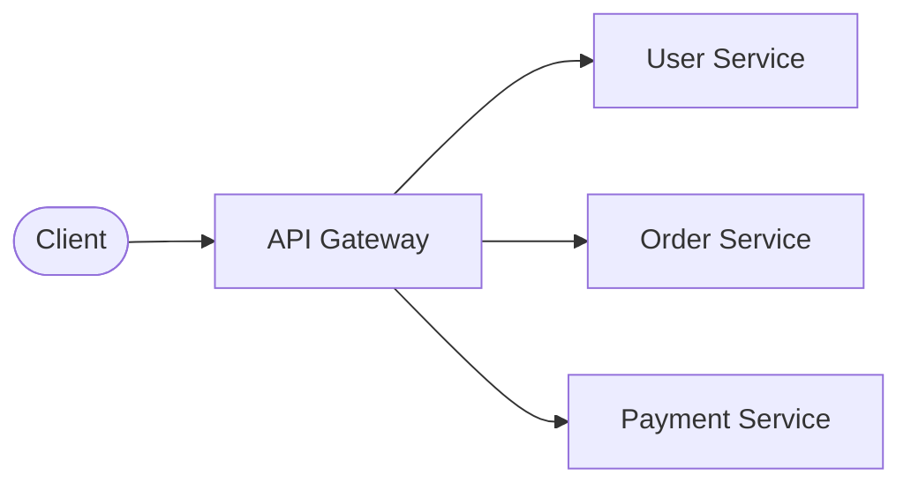
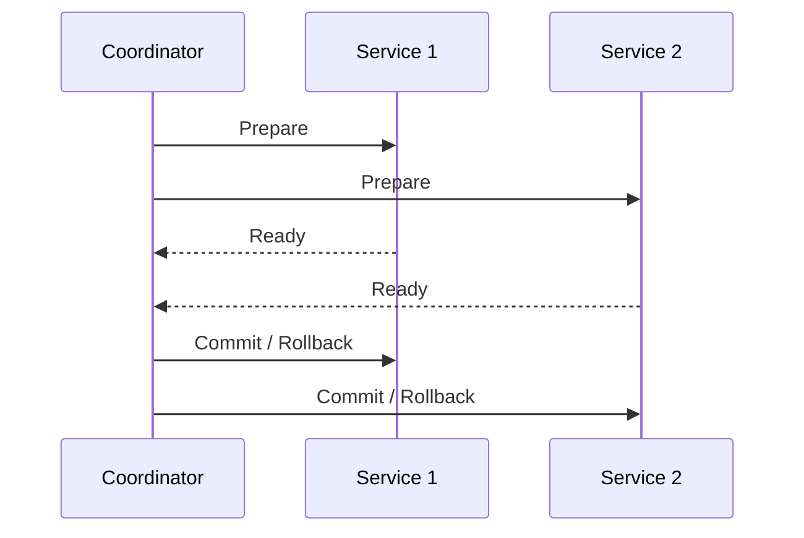
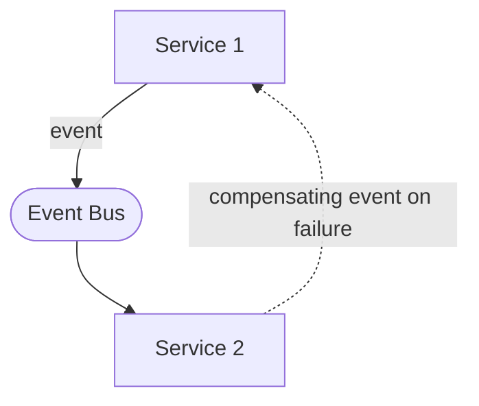
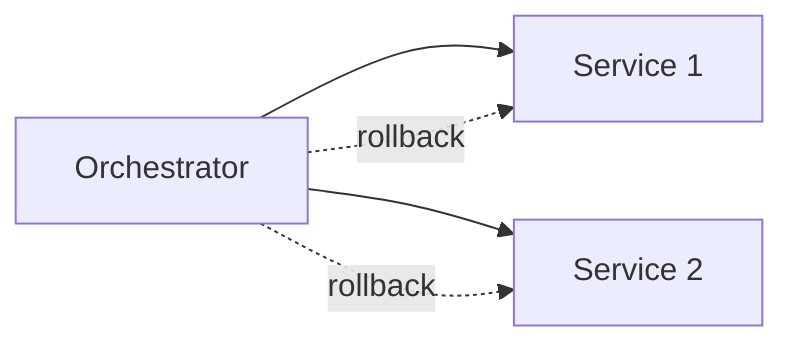

# System Design: Microservices

> Part of the [System Design](index.md) series.

---

## Monolith vs. Microservices

| Aspect | Monolith | Microservices |
|---|---|---|
| Definition | Self-contained features from UI to backend; one unified unit | App split into small independent services communicating over APIs, queues, and DB updates |
| Deployment | Deploy the entire codebase | Deploy one service independently |
| Scaling | Duplicate the entire application | Scale only the service under load |
| Fault isolation | A bug or regression can break the whole system | A bug in one service doesn't take down the whole app |
| Tech stack | Single language, single DB | Multiple languages; usually one DB per service |
| Code | Less duplication, faster to build initially | Logic may be duplicated across services |
| Responsibility | Too much in one unit as it grows | Less responsibility per service; easier to test |
| Development | Coupling slows teams down over time | Parallel development across teams is easier |

**When to stay monolith:** early stage, small team, domain boundaries aren't clear yet. A poorly split microservices system is worse than a monolith — you get the distributed systems complexity without the benefits.

**Interview note:** "I'd start with a monolith and extract services when a clear boundary emerges — a team owns it, it has distinct scaling needs, or it needs a different tech stack."

---

## API Gateway

An API gateway is the single entry point for all client requests. It sits in front of all microservices.

**What it does:**
- **Routing** — `/orders` → Order Service, `/users` → User Service
- **Authentication** — verify JWT/session once at the gateway, not in every service
- **Rate limiting** — throttle clients before the request reaches any service
- **Request aggregation** — combine calls to multiple services into one response (BFF pattern)
- **Protocol translation** — accept REST from clients, forward gRPC internally

---

## Service Discovery

In a microservices system, service instances come and go (auto-scaling, deploys, crashes). Service discovery lets services find each other without hardcoded IPs.

**Client-side discovery** — the client queries a **service registry** (e.g., Consul, Eureka) to get the list of healthy instances, then picks one and calls it directly. The client owns the load balancing logic.

**Server-side discovery** — the client calls a load balancer; the load balancer queries the registry and routes the request. The client doesn't need to know about the registry.

---

## Distributed Transactions

A transaction that spans multiple services — you can't use a single DB transaction across service boundaries.

### 2PC vs. SAGA

| | 2PC (Two-Phase Commit) | SAGA |
|---|---|---|
| Consistency model | Strong atomicity | Eventual consistency |
| Coordinator | A single coordinator manages all services | Choreographer (events) or Orchestrator (central) |
| Blocking | Client waits for all services to confirm | Each service commits locally |
| Failure | A failure can leave the transaction open across services | Rolls back previous steps via compensating transactions |
| Performance | O(slowest service) — synchronous | Async — faster overall |
| Complexity | Simpler logic, hard to implement correctly at scale | More complex rollback logic |

### 2PC Flow

### SAGA Flow

**Choreography (event-driven):** each service listens for events and publishes its own. No central coordinator. Harder to trace end-to-end.

**Orchestration:** a central orchestrator tells each service what to do and handles rollback explicitly. Easier to understand but the orchestrator becomes a potential SPOF.

**Interview note:** "For the checkout flow — reserve inventory, process payment, create order — I'd use a SAGA with orchestration. If payment fails, the orchestrator fires a compensating transaction to release the inventory reservation."
