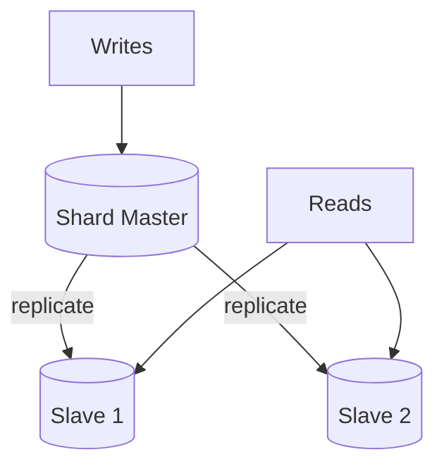

# System Design: Sharding

> Part of the [System Design](index.md) series.

---

## Partitioning vs. Sharding

**Partitioning** splits a single table into multiple physical segments on the **same server** — by date, range, type, etc. The database manages it transparently; the application usually doesn't know.

**Sharding** splits data across **multiple servers**. Each server (shard) owns a subset of the data. The application (or a shard router) must know which shard to query.

| | Partitioning | Sharding |
|---|---|---|
| Location | Same server | Multiple servers |
| Who manages routing | Database engine | Application or middleware |
| Scales | Storage and query performance on one node | Write throughput and total storage across nodes |

**Horizontal partitioning** — split by rows (e.g., users 1–1M on shard A, 1M–2M on shard B).
**Vertical partitioning** — split by columns (e.g., move rarely-read blobs into a separate table or store).

---

## Shard Key

The shard key determines which shard a row lives on: `shard = hash(shard_key) % N` (or via consistent hashing).

**What makes a good shard key:**
- **High cardinality** — enough distinct values to distribute data evenly across shards. `user_id` is good; `country` (only ~200 values) is risky.
- **Even distribution** — data and query load should spread uniformly. A key that skews (e.g., most users are in one city) creates hotspots.
- **Query alignment** — the most common queries should include the shard key in their filter, so they hit exactly one shard instead of all of them (scatter-gather).
- **Immutable** — if the shard key changes, the row must move to a different shard. Avoid shard keys that users update (email address, status).

---

## Hotspot Problem

A hotspot is when one shard receives disproportionately more traffic than the others — it becomes the bottleneck even though other shards are idle.

**Causes:**
- Bad shard key (low cardinality, skewed distribution)
- Time-based keys (all recent writes go to the "current" shard)
- Celebrity problem — one user/entity generates massive traffic (a viral post, a hot product)

**Fixes:**
- Apply consistent hashing to the shard key so load spreads automatically as shards are added/removed
- Add a random suffix to hot keys to split them across multiple shards (then aggregate on read)
- Use a compound shard key: `(user_id, created_at)` instead of just `created_at`

---

## Cross-Shard Queries

Queries that don't include the shard key must hit **all shards** (scatter-gather) and merge results. This is expensive.

**Mitigations:**
- Denormalize — store redundant data on each shard so the query can be answered locally
- Maintain a secondary lookup table that maps a secondary key to the shard ID
- Accept that some analytical queries are scatter-gather and run them asynchronously (not in the request path)

**Joins across shards** are especially painful — foreign keys don't cross shard boundaries. Design the data model so entities that join together live on the same shard (co-location by user_id, for example).

---

## Resharding

Adding or removing shards requires moving data — this is resharding. With naive modulo hashing, nearly all keys remap and data must be migrated en masse.

**Consistent hashing** minimizes this: adding one shard remaps only ~1/N of keys. See [consistent-hashing.md](04-consistent-hashing.md).

**Hierarchical sharding** — split each shard into virtual shards at the logical level. When a shard grows too large, split the virtual shard and move it to a new physical server without resharding everything else.

---

## Shard Failure: Master–Slave per Shard

Each shard runs its own master–slave replication. Writes go to the master; reads can be served by slaves. If the master fails, a slave is promoted.

---

## Gotchas

- Never use an auto-increment integer as a shard key — it always writes to the "last" shard, creating a hotspot.
- Create indexes on each shard independently — global indexes across shards don't exist natively.
- Application-level transactions across shards require 2PC or SAGA — shard boundaries mean no single DB transaction.
- **Shard last** — sharding is operationally complex. Exhaust vertical scaling, caching, and read replicas before sharding writes.
