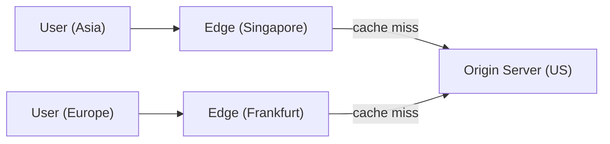

# System Design: CDN (Content Delivery Network)

> Part of the [System Design](index.md) series.

---

## What a CDN Does

A CDN is a globally distributed network of **edge servers** that cache content close to end users. Instead of every request traveling to the origin server, it hits the nearest edge node — dramatically reducing latency and offloading bandwidth from the origin.

**Without a CDN:** 100K users each download a 5 MB page → 500 GB served by your origin. High latency for distant users, high cost.

**With a CDN:** the edge serves cached copies. Origin only handles cache misses. Latency drops because the edge is physically closer to the user.

---

## What Gets Cached

**Static assets** — images, CSS, JS bundles, fonts, videos. These rarely change and are the primary CDN use case.

**Dynamic content** — API responses that are the same for all users (homepage HTML, product listings). Can be cached with short TTLs.

**Personalized content** — responses unique per user (shopping cart, dashboard). Generally not CDN-cached; must hit the origin.

---

## Pull vs Push CDN

**Pull CDN** — the edge fetches content from the origin on the first cache miss, caches it for a TTL, then serves subsequent requests from cache. Easy to set up; content is only cached once someone requests it. CloudFront, Cloudflare operate in pull mode.

**Push CDN** — you proactively upload content to the CDN before anyone requests it. Good for large files (videos, software downloads) that you know will be needed globally. More operational overhead.

Most web applications use pull.

---

## Cache Invalidation at the Edge

When you update a file, the CDN may serve the old version until the TTL expires.

**TTL expiry** — simplest approach. Set a short TTL for content that changes (HTML: minutes), long TTL for content that doesn't (versioned JS bundles: 1 year).

**Versioned URLs** — embed a hash or version in the filename: `app.v3f9a.js`. When the file changes, the URL changes. The old URL stays cached harmlessly; the new URL populates fresh. This is the standard approach for static assets.

**Explicit purge** — most CDNs (CloudFront, Fastly) provide an API to invalidate specific paths or the entire cache immediately. Use after content updates that can't wait for TTL.

---

## CDN for More Than Files

**Video streaming** — CDNs handle adaptive bitrate (ABR) streaming by caching video segments at the edge. Without this, every concurrent stream would hit the origin.

**DDoS mitigation** — CDN edge absorbs volumetric attacks before they reach the origin. The CDN's distributed surface area makes it hard to overwhelm.

**SSL termination** — the CDN terminates TLS at the edge, reducing latency (fewer round trips to the origin for TLS handshakes) and offloading cert management.

**Geographic restrictions (geo-blocking)** — CDNs can serve or block content based on the user's country, useful for licensing or compliance.

---

## When to Add a CDN

- You have static assets served globally
- Users in multiple regions are experiencing high latency
- Your origin is seeing high bandwidth costs
- You need DDoS protection at the edge

**Interview note:** "I'd put a CDN in front of all static assets from day one. For dynamic API responses that are the same for everyone (product catalog), I'd add a short TTL cache rule at the CDN layer to absorb read traffic during spikes."
