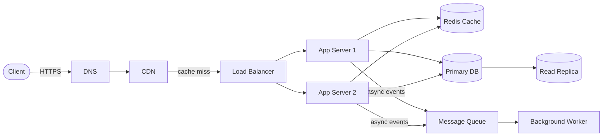

# System Design

> Structured learning notes for system design interviews. 12 sections, each with its own folder.

---

| # | Section | Folder |
|---|---|---|
| 1 | Fundamentals | [01-fundamentals/](01-fundamentals/index.md) |
| 2 | Networking | [02-networking/](02-networking/index.md) |
| 3 | Database Design | [03-database/](03-database/index.md) |
| 4 | Caching | [04-caching/](04-caching/index.md) |
| 5 | Messaging & Event-Driven | [05-messaging/](05-messaging/index.md) |
| 6 | Distributed Systems | [06-distributed-systems/](06-distributed-systems/index.md) |
| 7 | Security & Authentication | [07-security/](07-security/index.md) |
| 8 | Scalability & Performance | [08-scalability/](08-scalability/index.md) |
| 9 | Storage & Infrastructure | [09-storage/](09-storage/index.md) |
| 10 | Design Patterns | [10-design-patterns/](10-design-patterns/index.md) |
| 11 | Observability | [11-observability/](11-observability/index.md) |
| 12 | Exercises | [12-exercises/](12-exercises/index.md) |

---

## HLD Checklist (Interview Walkthrough)

When walking through any system design question, hit these in order:

1. **Clarify requirements** — scale (how many users, QPS, data volume), latency targets, consistency needs, read/write ratio
2. **Start with the simplest architecture** — single server + DB, then add complexity only as requirements demand
3. **Identify bottlenecks** — where will it fall over first? (usually: DB reads, DB writes, single node limits)
4. **Scale reads** — caching, read replicas, CDN for static assets
5. **Scale writes** — sharding, write-behind caching, message queues to absorb bursts
6. **Eliminate SPOFs** — redundancy at every layer (LB, DB, app servers, DNS)
7. **Handle failure modes** — what happens if the cache goes down? if the primary DB fails? if a downstream service is slow?
8. **Observability** — logging, metrics, tracing, alerting (you can't fix what you can't see)

---

## Architecture Flow (Baseline)

A typical production web system today:

